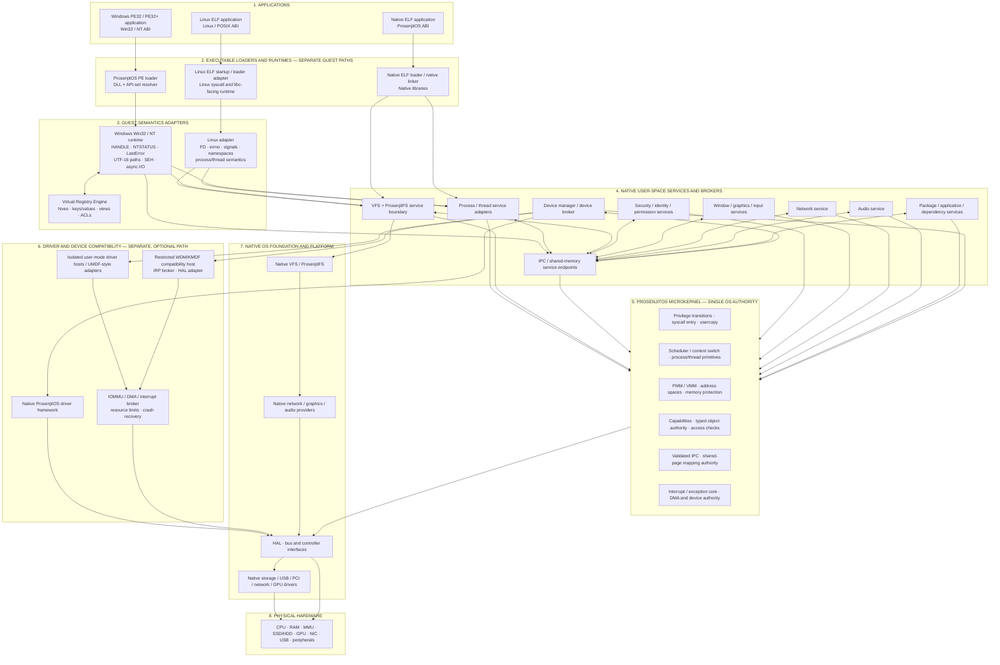

# ProsenjitOS Unified Native OS Architecture

**Status:** Target architecture and contributor orientation guide. This document explains the architecture visually; it does not change implementation status or the authoritative phase order.

**Authority:** `docs/COMPATIBILITY-FIRST-IMPLEMENTATION-MODEL.md` remains the sole authority for subsystem ownership, dependency order, and acceptance gates. This guide is a readable architecture map. Detailed contracts remain in the linked subsystem specifications.

## 1. The central idea

ProsenjitOS is one operating system with one native kernel authority. Native applications, Linux/POSIX applications, and Windows applications may enter through different executable loaders and ABI runtimes, but they ultimately use ProsenjitOS-owned native services and the same protected kernel, platform, and hardware resources.

- Native applications use the ProsenjitOS ABI directly.
- Linux applications use a separate Linux/POSIX compatibility runtime and guest-semantics adapters.
- Windows applications use a ProsenjitOS-owned PE loader, DLL/API-set resolver, and Win32/NT compatibility runtime.
- Compatibility runtimes do not contain or require a second OS kernel.
- Complex services and compatibility behavior remain in isolated user space wherever practical.
- The kernel enforces address-space isolation, capabilities, privilege transitions, IPC, and device authority.
- Native drivers are the preferred hardware path. Foreign driver compatibility is separately isolated and brokered.

This is a target design. The diagram does not imply that every service, runtime, or driver framework is implemented today.

## 2. Unified architecture diagram

The diagram shows conceptual relationships, not a mandatory single call chain. In particular, **ordinary application and service requests do not pass through the foreign-driver compatibility subsystem**. The device broker invokes a driver path only when a device operation is needed.

## 3. What each layer owns

### Layer 1 — Applications

Applications are untrusted clients. They request operations through their own ABI and receive only the permissions, handles, capabilities, and namespaces granted to them.

### Layer 2 — Executable loaders and runtimes

- **Native:** validates and starts supported native ELF images under the ProsenjitOS ABI.
- **Linux:** establishes Linux process-entry semantics and routes guest syscalls through an explicit Linux adapter.
- **Windows:** maps validated PE images, resolves DLL/API-set imports, and prepares Windows-compatible process startup.

A loader is not itself a complete compatibility environment. Image parsing, image loading, process execution, and application compatibility are separate verification milestones.

### Layer 3 — Guest-semantics adapters

This layer preserves ABI differences rather than erasing them.

- Linux keeps its own FD table, errno mapping, signal behavior, namespace view, and syscall-number translation.
- Windows keeps its own HANDLE table, NTSTATUS/LastError behavior, UTF-16 path rules, registry semantics, SEH/unwind behavior, and asynchronous I/O contracts.
- Native applications use the native object and syscall contracts directly.

Windows Registry is a compatibility service with its own logical hive/key/value, transaction, view, and access-control model. It is not merely a directory of ordinary files.

### Layer 4 — Native user-space services and brokers

These services implement complex OS functionality outside the privileged kernel wherever practical. They include filesystem/VFS providers, networking, graphics/windowing, audio, package management, security/identity policy, process-management adapters, and device management.

The service manager, process/thread service adapters, and kernel process/thread primitives are not interchangeable concepts. User-space services coordinate policy and higher-level behavior; the kernel retains the primitive authority to create/schedule protected execution contexts and enforce memory and capability boundaries.

Services communicate through versioned, validated IPC contracts. Shared memory is used only with explicit mapping rights, ownership, synchronization, lifetime, and revocation rules.

### Layer 5 — ProsenjitOS microkernel

The kernel is the single authority for:

- privilege transitions, syscall entry, and validated user-memory access;
- scheduling, context switching, and minimal process/thread primitives;
- physical and virtual memory management and address-space protection;
- capability and typed-object enforcement;
- validated IPC and shared-memory mapping authority;
- interrupt/exception entry and device, DMA, and IOMMU authority.

The target is microkernel-oriented and reached incrementally. Existing kernel-resident subsystems must not be described as already migrated to user space until their service ABI, lifecycle, isolation, failure recovery, and regression gates pass.

### Layer 6 — Driver and device compatibility

This is a **device-specific branch**, not a mandatory layer between all applications and the kernel.

1. Native ProsenjitOS drivers are preferred.
2. User-mode drivers and UMDF-style compatibility are the first foreign-driver direction.
3. WDM/KMDF compatibility is a later, restricted research target requiring a separate threat model and verified IRP, memory, interrupt, DMA, IOMMU, device ownership, and recovery contracts.
4. A Windows `.sys` or Linux `.ko` image must never be loaded as an ordinary ProsenjitOS kernel module.

The device broker controls access. Driver hosts must not receive unrestricted physical memory, kernel pointers, arbitrary MMIO/port access, or unmediated DMA.

### Layer 7 — Native OS foundation and platform

This layer supplies the native implementations and hardware-facing providers used by services:

- native VFS and ProsenjitFS storage implementation;
- native network, graphics, and audio providers;
- HAL and bus/controller abstractions;
- native storage, PCI/PCIe, USB/xHCI, network, GPU, and other drivers.

The exact placement of a provider (kernel, user space, or isolated driver host) is governed by its subsystem contract and migration gate, not by this overview diagram.

### Layer 8 — Physical hardware

The hardware is accessed through kernel-enforced platform and device interfaces. Applications and compatibility runtimes never receive unrestricted hardware authority.

## 4. Execution flows

### Native application

`Native ELF → Native loader/linker → Native ABI → native service APIs / syscalls → kernel-enforced resources`

A native application does not pass through Linux or Windows translation.

### Linux/POSIX application

`Linux ELF → Linux startup/runtime → Linux syscall/API adapter → Linux semantic adapters → native services and kernel primitives`

Linux guest syscall numbers, FD values, errno values, and signal semantics must not be treated as native equivalents without explicit translation.

### Windows application

`Windows PE → ProsenjitOS PE loader → DLL/API-set resolver → Win32/NT runtime → Windows semantic adapters → native services and kernel primitives`

Each Windows API must be classified as a direct equivalent mapping, a native user-space service implementation, a composite compatibility operation, or deterministically unsupported. A success-returning placeholder is not compatibility.

### Device request

`Application/service → device broker → authorized native or isolated driver host → HAL / kernel device authority → hardware`

Only device-related requests take this branch. The Windows driver-compatibility host is optional and later-stage; native drivers remain the preferred path.

## 5. Non-negotiable boundaries

- **One OS authority:** no Windows kernel, Linux kernel, second OS installation, or Wine runtime is required.
- **Separate ABIs:** Native, Linux, and Windows semantics remain separate at their boundaries.
- **User-space first:** complex compatibility code, parsers, registry behavior, and service logic stay outside privileged kernel code wherever practical.
- **Kernel-enforced security:** adapters and services cannot grant themselves capabilities or bypass authorization.
- **Service isolation:** services require versioned interfaces, capability policy, resource budgets, startup/shutdown, health, and bounded recovery contracts.
- **Driver isolation:** foreign drivers are never ordinary native kernel modules; DMA, interrupts, MMIO, and device ownership are brokered.
- **No false completion claims:** this is the target architecture, not proof that each block exists or is production-ready.
- **Wine policy:** Wine may be studied as an architectural/behavioral reference only. ProsenjitOS must not depend on, embed, or require the Wine runtime.

## 6. Where to find implementation detail

| Topic | Canonical document |
|---|---|
| Overall architecture, phase order, acceptance gates, contributor handoff | [COMPATIBILITY-FIRST-IMPLEMENTATION-MODEL.md](COMPATIBILITY-FIRST-IMPLEMENTATION-MODEL.md) |
| Concise OS overview and current source-backed architecture notes | [ARCHITECTURE.md](ARCHITECTURE.md) |
| Native foundation facts and known gaps | [FOUNDATION-AUDIT.md](FOUNDATION-AUDIT.md) |
| Native process launch, CPL3 frame, scheduler handoff, teardown | [NATIVE-SPAWN-CONTRACT.md](NATIVE-SPAWN-CONTRACT.md) |
| Windows PE/DLL/Win32/NT runtime design | [V2-UNIFIED-APPLICATION-RUNTIME.md](V2-UNIFIED-APPLICATION-RUNTIME.md) |
| Native, user-mode, and foreign driver model | [DRIVER-MODEL.md](DRIVER-MODEL.md) |
| VFS, ProsenjitFS, storage and filesystem contracts | [FILESYSTEM.md](FILESYSTEM.md) |

## 7. Implementation status and phase authority

The canonical implementation order remains Phase 0–10 in `COMPATIBILITY-FIRST-IMPLEMENTATION-MODEL.md`. This visual guide creates no new phase, does not reorder dependencies, and does not authorize parallel dependent implementation.

Before implementation, contributors must inspect the current source and tests, identify the earliest unmet dependency gate, and write the relevant Detailed Implementation Specification. A subsystem is complete only when its documented success, malformed-input, permission-denial, resource-exhaustion, rollback, teardown, integration, and security tests pass on the exact candidate commit.

**Remember:** the diagram explains where components belong. The master specification decides when they may be implemented. The subsystem specification decides their exact contracts. Source and test evidence decide whether they are complete.
